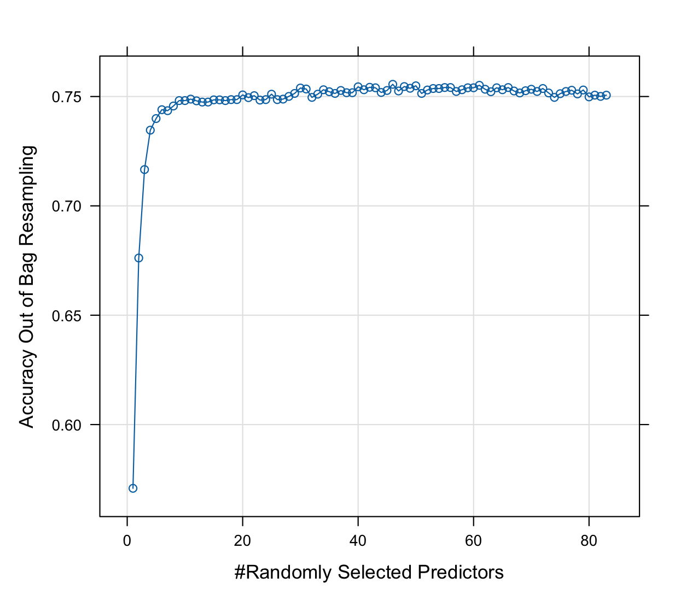
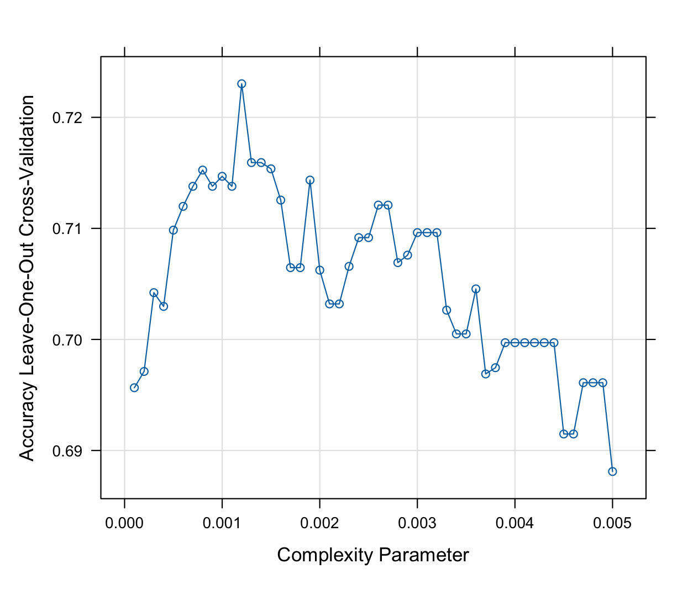

# In-Vehicle Coupon Utilization Prediction

**STAT 502 · Iowa State University · Spring 2024**

**Team:** Monica Anang, David Ayikambey, Gabriel Arthur, and Fredrick Osei.

Predicting whether a survey respondent would accept a coupon in a described driving scenario, using demographic, contextual, and coupon attributes. This course project compares eight classification methods and examines the trade-off between training fit and test performance.

**[Read the team report and presentation](STAT502projMain.pdf)**

## Data and workflow

The source is the [UCI In-Vehicle Coupon Recommendation dataset](https://archive.ics.uci.edu/dataset/603/in+vehicle+coupon+recommendation): 12,684 observations and 25 features, plus the response. These are survey responses to hypothetical driving scenarios, not measured real-world coupon redemptions.

The original workflow used random-value imputation, numerical recoding of age and income, and categorical encoding, producing 83 predictors and a `yes`/`no` response. The supplied split contains **8,878 training rows** and **3,806 test rows**. The original data, processed data, and fixed splits are included.

Compared methods:

- K-nearest neighbors
- Classification tree
- Random forest
- XGBoost
- AdaBoost
- Penalized logistic regression
- Linear discriminant analysis
- Neural network

Hyperparameter selection used repeated cross-validation, leave-one-out cross-validation, or out-of-bag evaluation, depending on the method. R's `targets` package organized the modeling pipeline.

## Results reported in the coursework

These test accuracies are rounded from the report's confusion matrices/agreement table. They are **historical reported results**, not a new full comparison run during repository preparation.

| Method | Test accuracy |
| --- | ---: |
| Random forest | 74.6% |
| AdaBoost | 74.0% |
| XGBoost | 72.6% |
| Classification tree | 70.4% |
| Neural network | 69.2% |
| Penalized logistic regression | 67.2% |
| K-nearest neighbors | 66.9% |
| Linear discriminant analysis | 59.4% |

Random forest had the highest reported test accuracy. Several flexible models had much higher training accuracy, motivating discussion of generalization and overfitting. Some prose and slide percentages differ from the report's tables; the table above consistently uses the tabulated results.

### Original tuning figures





The `figures/` folder also includes the supplied KNN, boosting, logistic-regression, neural-network, and pipeline diagrams.

## Quick run

For a manageable check of the included data and a current-environment refit of the classification tree at the original fixed `cp = 0.0012`, install `rpart` if needed:

```r
install.packages("rpart")
```

Then run from the repository root:

```sh
Rscript --vanilla run.R
```

This writes train/test accuracy, test predictions, a confusion matrix, and software-session information under `outputs/`. It does **not** rerun tuning or reproduce all eight classifiers. This quick run completed successfully during preparation, with 70.415% test accuracy and a test confusion matrix matching Table 16 of the report.

## Full original pipeline

The root `_targets.R` reads the supplied train/test files using relative paths. Package requirements declared by the original pipeline are:

```r
c("targets", "tibble", "dplyr", "ggplot2", "caret", "rpart",
  "xgboost", "randomForest", "fastAdaboost", "glmnet", "nnet", "MASS", "klaR")
```

Install compatible versions of these packages before attempting `targets::tar_make()`. Additional preprocessing/evaluation functions reference `stringr` and `knitr`. Historical package versions were not supplied, and availability/compatibility of the full dependency set has not been established here. In particular, no promise is made that all packages install together on a current R release.

Full execution can be expensive: the code includes leave-one-out tree tuning and large repeated cross-validation grids. It also has documented limitations involving the disabled LDA branch and evaluation script. Review [REPRODUCIBILITY.md](REPRODUCIBILITY.md) first. The quick-run entry point is the validated workflow in this prepared package.

## Files

| File or folder | Purpose |
| --- | --- |
| `STAT502projMain.pdf` | Original team report and presentation |
| `_targets.R`, `functions.R` | Modeling pipeline and helper functions |
| `preprocessing.R` | Original preprocessing with input path made relative |
| `evaluation.R` | Original interactive evaluation commands |
| `initialdata.csv` | Supplied original data |
| `preprocesseddata.csv` | Supplied processed export, including a row-index column |
| `train_set1.csv`, `test_set1.csv` | Fixed train/test data, without that row-index column |
| `ldatp.csv` | Supplied historical LDA test predictions from the project folder |
| `figures/` | Selected original figures |
| `original-code/` | Unchanged originals of the two scripts whose local paths were replaced |
| `run.R` | Added classification-tree check |
| `REPRODUCIBILITY.md` | Verification details and limitations |

## Contributions and attribution

The report credits all four team members. Its activity statement records that Fredrick cleaned the data and ran some classification methods; the other team members also worked on data and classifiers. No more specific division of model ownership is asserted here.

**Dataset citation:** In-Vehicle Coupon Recommendation [Dataset]. (2017). UCI Machine Learning Repository. https://doi.org/10.24432/C5GS4P. UCI lists the dataset under [CC BY 4.0](https://creativecommons.org/licenses/by/4.0/). The processed files and splits are coursework transformations of the source data; this dataset license does not assign a license to the team's report or code.

Fredrick's [academic website](https://foseistats.github.io/) · [GitHub](https://github.com/foseistats) · [LinkedIn](https://www.linkedin.com/in/fredrick-osei-ms-813837224)
